<!-- Banner: scripts/banner/generate.py üretir (yerelde bir kez). Fotoğraf: assets/source/portrait.png -->
<picture>
  <source media="(prefers-color-scheme: dark)" srcset="assets/banner-dark.svg">
  <source media="(prefers-color-scheme: light)" srcset="assets/banner-light.svg">
  
</picture>

 

<a href="https://www.miracdeprem.com">
  <picture>
    <source media="(prefers-color-scheme: dark)" srcset="https://readme-typing-svg.demolab.com?font=JetBrains+Mono&weight=600&size=22&duration=2800&pause=900&color=F5C77E&center=true&vCenter=true&width=820&lines=Full-stack+Software+Developer;Web%2C+desktop+and+mobile+apps%2C+live+or+downloadable;Computer+Engineering%2C+Class+of+2026+%C2%B7+Istanbul">
    
  </picture>
</a>

 

&nbsp;
&nbsp;
&nbsp;

 

 

### 01 · Stack

 

### 02 · Selected Projects

<table width="100%">
<tr>
<td width="50%" valign="top">

**🔐 Cipher** &nbsp;graduation project · published
 
End-to-end encrypted P2P messaging. A Go networking and crypto core connects over WebRTC, falls back to UDP and then to an encrypted relay, and is bridged to Flutter with Gomobile.
 
`Go` `Flutter` `WebRTC`
 
→ [project page](https://www.miracdeprem.com/projects/cipher) · [paper (DOI)](https://doi.org/10.35444/IJANA.2026.18210)

</td>
<td width="50%" valign="top">

**🗝️ Password Vault** &nbsp;desktop · downloadable
 
Password manager with one encrypted vault file: Argon2id key derivation, XChaCha20-Poly1305, atomic saves and wiped key memory. Password health, k-anonymity breach check, 2FA codes and browser CSV import.
 
`C++` `Qt` `libsodium`
 
→ [repo](https://github.com/MrcDprm/security-app) · [download](https://github.com/MrcDprm/security-app/releases/latest)

</td>
</tr>
<tr>
<td width="50%" valign="top">

**📦 Zarf** &nbsp;web + CLI · live
 
End-to-end encrypted file sharing: files are encrypted on the device and the key stays in the part of the link after `#`, so the server never sees it. Send a link, request files, or send with a short code, in the browser or from the command line.
 
`Go` `TypeScript` `WebRTC`
 
→ [repo](https://github.com/MrcDprm/zarf-file-share) · [live demo](https://zarf.miracdeprem.com)

</td>
<td width="50%" valign="top">

**🕵️ KVKK Document Assistant** &nbsp;AI · live
 
Ask an AI model about documents full of Turkish personal data without sending that data to it. Names, ID numbers, IBANs and more are masked by rules plus a Turkish BERT model I trained; long documents go through RAG, and the real values are restored only on the server.
 
`Python` `FastAPI` `ONNX`
 
→ [repo](https://github.com/MrcDprm/kvkk-document-assistant) · [live demo](https://kvkk.miracdeprem.com)

</td>
</tr>
<tr>
<td width="50%" valign="top">

**🎬 Seans** &nbsp;web · live
 
Cinema booking with a live seat map, seat holds that expire, Stripe payments, signed QR tickets and a door check screen for staff.
 
`React` `Express` `PostgreSQL`
 
→ [repo](https://github.com/MrcDprm/movie-reservation-system) · [live demo](https://seans.miracdeprem.com)

</td>
<td width="50%" valign="top">

**❓ Quiz App** &nbsp;web · live
 
Quiz with categories and easy/medium/hard levels. Play with friends using a room code on a Node.js room server, with AI-written questions checked by a second model. Answers stay on the server, so the quiz can't be cheated from dev tools.
 
`JavaScript` `Node.js` `Vercel Functions`
 
→ [repo](https://github.com/MrcDprm/quiz-app) · [live demo](https://quiz.miracdeprem.com)

</td>
</tr>
<tr>
<td width="50%" valign="top">

**📚 Sahaf** &nbsp;web · live
 
Online bookshop for public-domain classics in its own cover series, with every cover drawn by the app. Stripe checkout, bulk orders for schools, an admin panel and full Turkish/English support.
 
`C#` `ASP.NET Core` `PostgreSQL`
 
→ [repo](https://github.com/MrcDprm/sahaf-bookstore) · [live demo](https://sahaf.miracdeprem.com)

</td>
<td width="50%" valign="top">

**🎭 Spy Game** &nbsp;web · live
 
Real-time party game for 3–12 players, each on their own phone: one player is the spy who doesn't know the location. Rooms, roles and voting run over SignalR with Redis.
 
`C#` `SignalR` `Redis`
 
→ [repo](https://github.com/MrcDprm/spy-game) · [live demo](https://spygame.miracdeprem.com)

</td>
</tr>
</table>

All projects, with problem → solution → outcome write-ups: <a href="https://www.miracdeprem.com/projects">miracdeprem.com/projects</a>

 

### 03 · Publication

> **Cipher: An End-to-End Encrypted Peer-to-Peer Instant Mobile Messaging System** 
> **M. Deprem**, E. A. Koca, A. A. Süzen · *International Journal of Advanced Networking and Applications (IJANA)*, Vol. 18, Issue 2, pp. 7461–7466, 2026 
> [doi.org/10.35444/IJANA.2026.18210](https://doi.org/10.35444/IJANA.2026.18210)

 

### 04 · Stats

<!-- Kartlar: scripts/cards.py üretir, .github/workflows/cards.yml her saat "cards" dalına yazar -->
<picture>
  <source media="(prefers-color-scheme: dark)" srcset="https://raw.githubusercontent.com/MrcDprm/mrcdprm/cards/card-streak-dark.svg">
  <source media="(prefers-color-scheme: light)" srcset="https://raw.githubusercontent.com/MrcDprm/mrcdprm/cards/card-streak-light.svg">
  
</picture>

<picture>
  <source media="(prefers-color-scheme: dark)" srcset="https://raw.githubusercontent.com/MrcDprm/mrcdprm/cards/card-stats-dark.svg">
  <source media="(prefers-color-scheme: light)" srcset="https://raw.githubusercontent.com/MrcDprm/mrcdprm/cards/card-stats-light.svg">
  
</picture>
<picture>
  <source media="(prefers-color-scheme: dark)" srcset="https://raw.githubusercontent.com/MrcDprm/mrcdprm/cards/card-languages-dark.svg">
  <source media="(prefers-color-scheme: light)" srcset="https://raw.githubusercontent.com/MrcDprm/mrcdprm/cards/card-languages-light.svg">
  
</picture>

  

<picture>
  <source media="(prefers-color-scheme: dark)" srcset="https://raw.githubusercontent.com/mrcdprm/mrcdprm/output/github-contribution-grid-snake-dark.svg">
  <source media="(prefers-color-scheme: light)" srcset="https://raw.githubusercontent.com/mrcdprm/mrcdprm/output/github-contribution-grid-snake.svg">
  
</picture>

  

miracdeprem.com · Istanbul

